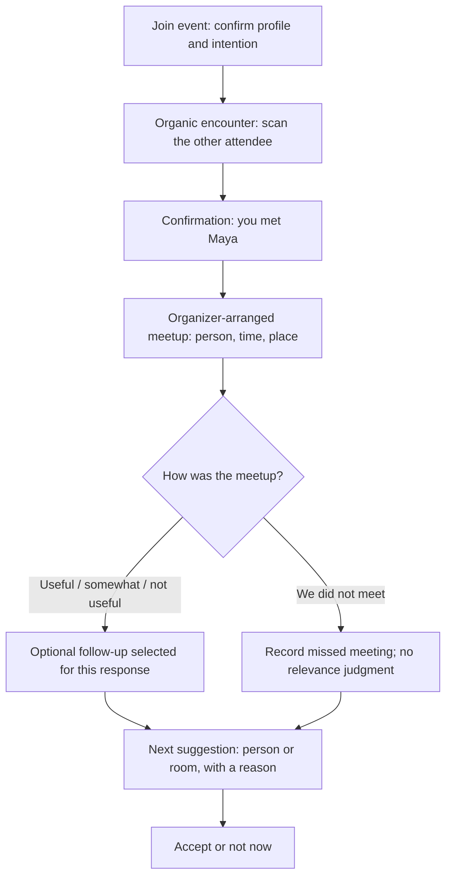
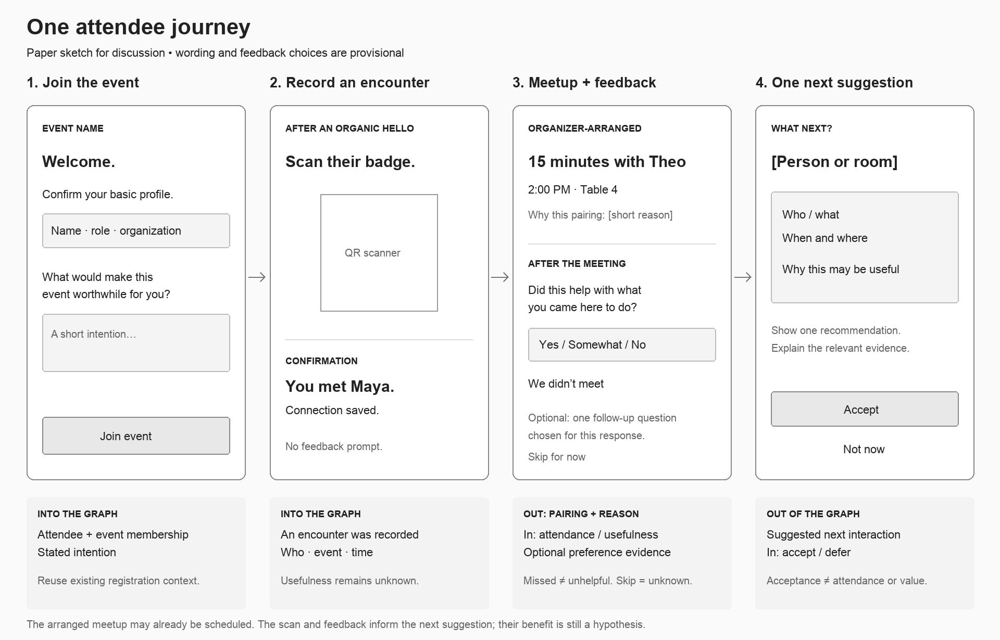

# Earlier attendee flow — superseded discussion draft

The current discussion is in [Side-by-side invitation sketches](LOOP-SKETCHES.md), which adds exhibitor invitations and a peer branch to the attendee graph. This earlier, narrower journey is retained for reference. The existing prototype remains set aside; neither document authorizes implementation.

## One end-to-end journey

The arranged meeting may have been scheduled before the organic encounter. This sketch does not claim that the scan caused that pairing. Its purpose is to explore what changes in the next recommendation.

## Paper screens

This groups the arranged-meeting details and subsequent feedback into one journey step; they are two successive screen states. Bracketed text remains undecided.

| Screen | Attendee sees | Attendee does | Graph input or output |
| --- | --- | --- | --- |
| Join | Event name, basic profile, “What would make this event worthwhile?” | Confirm identity and express an intention. | Attendee node, event membership, stated goal. Registration fields can supply existing context. |
| Scan → confirmation | Scanner, then the person's name and “You met Maya.” | Scan after an encounter. | Encounter evidence with event and time. No survey, rating, or inferred buying intent. |
| Arranged meetup | Person, time, location, and a plain-language reason for the pairing. | Attend the meeting. | A proposed match comes out. A scheduled meeting alone does not add confirmed attendance. |
| Feedback | One usefulness prompt and an optional follow-up. “We didn't meet” is available. | Answer briefly or skip. | Attendance state, reported usefulness, and any explicit preference. Missing feedback stays unknown. |
| Next suggestion | One person or evening room; why it might help; Accept / Not now. | Accept, defer, or decline. | Recommendation comes out; preference/action comes in. Acceptance does not prove attendance or usefulness. |

## Feedback to discuss

First prompt: **“Did this conversation help with what you came here to do?”**

Choices: **Yes / Somewhat / No / We didn't meet**.

The first three are usefulness responses to a meeting the attendee says happened. “We didn't meet” records a missed meeting and bypasses relevance feedback. Skipping the prompt means unknown, not negative.

An optional second question should resolve one uncertainty relevant to the next suggestion. Candidate examples, not an approved questionnaire:

| Uncertainty | Candidate question | How the answer could affect the next suggestion |
| --- | --- | --- |
| What made a useful meeting valuable? | “What helped most?” — shared challenge / relevant experience / potential collaboration | Separate common interests from complementary expertise or collaboration potential. |
| Why was a meeting unhelpful? | “What was missing?” — relevant topic / different experience / a clear reason to meet | Adjust the next candidate or improve the introduction context. |
| Is there insufficient evidence? | Omit a second question. | Continue using stated goals and other available signals; do not invent certainty. |

The graph teammate can eventually select a question from a small approved set. Dynamic generation is a hypothesis to explore; this flow does not require it. Feedback evaluates the interaction for this attendee, not the general worth of the other person.

## Decisions still open

1. What is the example attendee trying to achieve? Keep this as a placeholder until discussed.
2. Does the first recommendation mock show a next meetup or an evening room?
3. Which uncertainty can the graph actually act on, and therefore deserves a feedback question?

A rough paper sketch is included above for discussion. The example attendee goal, final suggestion type, and feedback choices remain open. Further UI implementation is waiting for that discussion; the existing prototype remains set aside.
