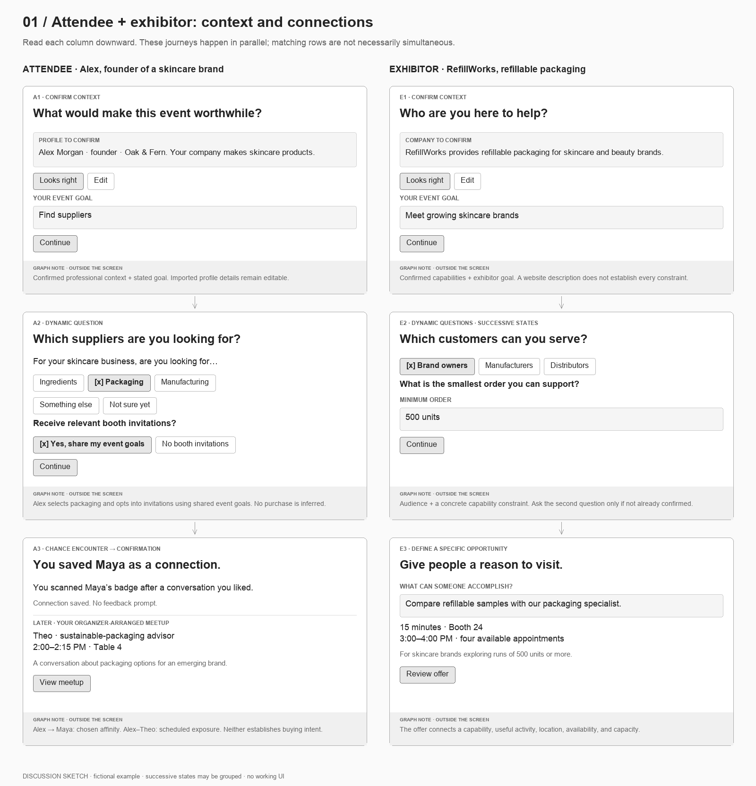
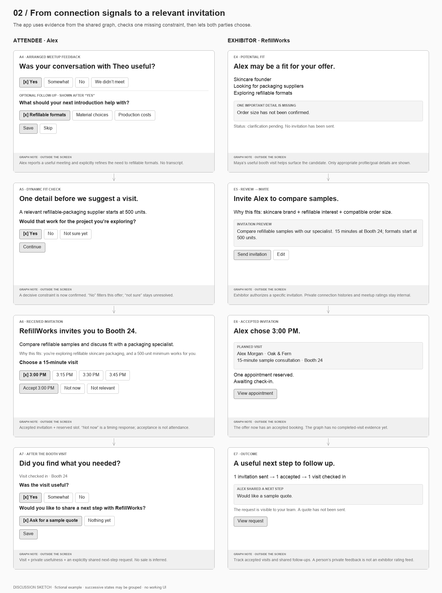
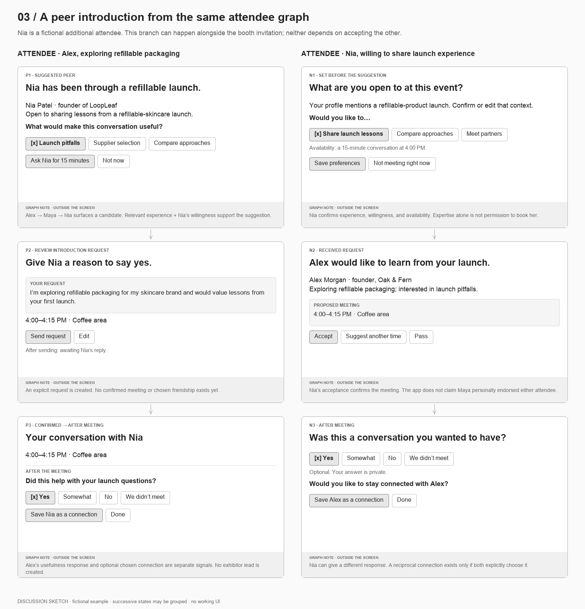
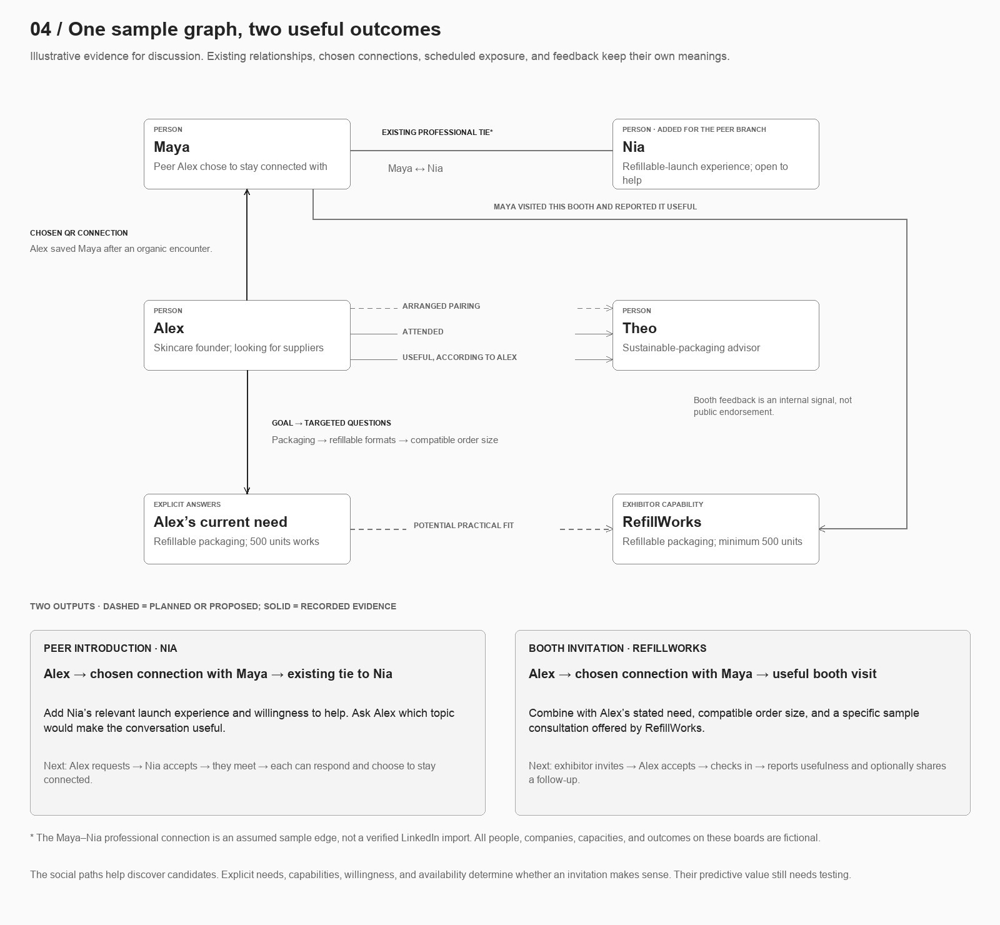

# One attendee graph, two invitation flows

Discussion draft · 24 October 2026. Static, low-fidelity sketches only. The existing application remains set aside.

The attendee graph supplies context for both relevant exhibitor invitations and useful peer conversations. Social connections help discover candidates; explicit needs, capabilities, willingness, and availability determine whether an invitation makes sense. This is a product hypothesis, not demonstrated recommendation performance.

## Read the sketches

Read each column downward. Rows align stages for comparison, not necessarily simultaneous actions. Some cards group successive states to keep the paper flow compact. Gray strips are discussion notes about graph signals, outside the proposed interface.

1. [Context, dynamic questions, and connections](sketches/01-context-and-connections.png)
2. [From signals to a specific booth invitation](sketches/02-from-signal-to-invitation.png)
3. [Attendee-to-attendee invitation](sketches/03-attendee-to-attendee.png)
4. [Expanded sample graph](sketches/04-expanded-sample-graph.png)

Each PNG has an editable SVG with the same filename. All people, companies, capacities, relationships, and outcomes are fictional. This extends the skincare example from our discussion without changing the older technology-event fixtures in `src/demo.js`.

## The sample cast

| Person or company | Context |
| --- | --- |
| Alex Morgan, Oak & Fern | Skincare founder looking for suppliers; answers refine this to refillable packaging. |
| Maya | Someone Alex liked meeting and deliberately saved by scanning a QR code. Previously visited RefillWorks and found it useful. |
| Theo | Sustainable-packaging advisor in an organizer-arranged meeting with Alex. |
| Nia Patel, LoopLeaf | Added peer candidate: has launched refillable skincare products and is willing to share lessons. Has an assumed professional connection with Maya. |
| RefillWorks | Refillable-packaging exhibitor with a 500-unit minimum; offers a 15-minute sample consultation at Booth 24. |

The Maya–Nia connection is an assumed sample edge, not evidence that profile enrichment supplies LinkedIn connections.

## Attendee and exhibitor loop

Alex confirms professional context, states a goal, and answers a question grounded in that context: which kind of supplier? Alex also chooses whether to receive booth invitations using shared event goals. The exhibitor confirms its offering and answers complementary questions: who can it help, and what practical constraints apply?

Alex scans Maya after a chance meeting. The scan is a deliberate choice to save Maya; there is no survey and no inferred topic or buying intent. The arranged meeting with Theo is shown as a separate scheduled interaction, not a consequence of that scan.

After the meeting with Theo, Alex reports usefulness. An optional question narrows the next need to refillable formats. Maya’s useful RefillWorks visit helps surface a candidate; Alex’s need and RefillWorks’ capabilities support the fit. A targeted question resolves the remaining uncertainty: would a 500-unit minimum work?

RefillWorks reviews a candidate with a concrete reason to invite and a specific benefit to offer. The exhibitor sees the shared event need and practical fit, not Alex’s private encounter history or Maya’s private feedback. Alex receives the invitation, sees why it fits, and chooses a slot.

The loop closes with a visit check-in, private usefulness feedback, and an optional next step explicitly shared with RefillWorks. Asking for a sample quote is an outcome; it is not a sale. The exhibitor sees sent, accepted, and checked-in states separately.

## Attendee-to-attendee branch

Alex’s chosen connection to Maya, and Maya’s existing connection to Nia, surface Nia as a possible introduction. Nia’s confirmed launch experience and willingness to share lessons make the suggestion actionable. The graph path alone does not imply endorsement or consent to meet.

Alex answers one question about what would make the conversation useful: launch pitfalls, supplier selection, or comparing approaches. The answer becomes the purpose of a concrete request. Nia can accept, suggest another time, or pass. In this version, Alex requests directly; Maya is not automatically asked to introduce them or represented as endorsing the meeting.

After the meeting, each attendee can give private feedback and independently choose to save the other. Neither acceptance nor one person’s saved connection creates mutual approval. This branch works without a booth invitation and does not automatically create an exhibitor lead.

## When a dynamic question earns its place

| Moment | Uncertainty | Question shown in the example | Effect |
| --- | --- | --- | --- |
| Alex joins | Which suppliers? | Ingredients, packaging, manufacturing, something else, or not sure? | Uses skincare context to translate a broad goal into a useful direction. |
| Exhibitor joins | Which audience? | Brand owners, manufacturers, or distributors? | Establishes which attendees the offering can serve. |
| Exhibitor confirms capabilities | A hard constraint is missing | What is the smallest order you can support? | Supplies a practical fit condition. |
| After Theo meeting | Which next step would help? | Refillable formats, material choices, or production costs? | Explicitly refines the need; does not guess what was discussed. |
| Before booth invitation | Is the minimum feasible? | Would 500 units work for your project? | Yes supports the invitation; no filters it; unsure remains unresolved. |
| Nia sets preferences | Is expertise available to others? | Share launch lessons, compare approaches, or meet partners? | Distinguishes experience from willingness to help. |
| Before peer request | What should they discuss? | Launch pitfalls, supplier selection, or compare approaches? | Gives both people a clear purpose for the invitation. |

Ask only when an answer could change the next action, and skip questions already answered. Imported or inferred context stays editable. These examples describe selection logic, not a fixed questionnaire or a commitment to generated questions.

## Expanded sample graph

Keep relationship types and their sources separate. These are sample records for discussion, not a backend schema.

| Relationship or state | Source and meaning |
| --- | --- |
| Alex → Oak & Fern; Alex → supplier goal | Confirmed professional context and stated event goal, A1. |
| Alex → packaging; Alex → booth-invitation preference | Explicit answers, A2; invitation preference can be changed. |
| Alex → Maya: chosen connection | QR save, A3. Directional; no survey, topic, or endorsement inferred. |
| Alex ↔ Theo: arranged pairing | Organizer schedule, A3; not proof of attendance. |
| Alex → Theo meeting: attended, useful | Alex’s feedback, A4; separate reported states, not reciprocal approval. |
| Alex → refillable formats | Explicit next-interest answer, A4. |
| Alex → 500-unit minimum works | Explicit fit answer, A5; not a purchase commitment. |
| Maya ↔ Nia: existing professional tie | Assumed fixture. Would need a separate actual source in a working product. |
| Maya → RefillWorks visit; Maya → usefulness | Fictional prior check-in and private feedback. Candidate discovery signal, not public endorsement. |
| Nia → refillable-launch experience, willingness, availability | Confirmed preferences, N1. |
| RefillWorks → capabilities, audience, 500-unit minimum | Confirmed exhibitor inputs, E1–E2. |
| RefillWorks → sample consultation | Offer, location, slots, and capacity, E3. |
| RefillWorks → Alex: invitation sent; Alex → accepted | E5 and A6 are distinct actions. |
| Alex → booth visit; Alex → quote request | Check-in and explicitly shared follow-up, A7. No sale inferred. |
| Alex → Nia: request sent; Nia → accepted | P2 and N2; confirmation is not attendance. |
| Alex / Nia → meeting feedback; each → optional saved connection | Separate private responses and directional choices, P3/N3. |

The two useful paths are:

- **Booth:** Alex → chosen connection with Maya → useful booth visit → RefillWorks, checked against Alex’s explicit need and the exhibitor’s actual offering.
- **Peer:** Alex → chosen connection with Maya → professional tie to Nia, checked against relevant experience, willingness, purpose, and availability.

Both paths can generate candidates before there is enough evidence to invite. A graph with few connections should still use confirmed goals and capabilities; it should not invent relationships.

## Alternative responses to retain

- No booth invitations: keep peer suggestions available.
- “We didn’t meet”: record a missed meeting, not negative relevance.
- Skipped feedback: unknown, not negative.
- Minimum order does not fit: look for a compatible offer. “Not sure” is not yes.
- “Not now”: defer for timing. “Not relevant”: optionally ask which aspect missed the mark.
- Nia passes or proposes another time: do not show a confirmed meeting until both agree.
- A slot fills: offer remaining slots or a different opportunity.

## Decisions to discuss next

1. Should the exhibitor see a candidate with one unresolved constraint, as drawn, or only after the fit question is answered?
2. Is the first offer a booked consultation, as drawn, or a drop-in invitation?
3. Should the peer request go directly to Nia, as drawn, or offer an optional introduction through Maya?

These are discussion choices, not implementation gates. The earlier attendee-only sketch remains in `FLOW.md` for reference.
